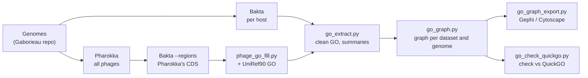

# phage-host-go

Gene Ontology (GO) terms and GO graphs for the phages and bacterial hosts of the Gaborieau *et al.* (2024) *E. coli* phage–host interaction dataset. This repository holds the pipeline that gives every gene its GO terms and draws them as graphs, and the results for 401 hosts and 96 phages.

The scripts need only the Python standard library. The annotation tools they read from (Bakta, Pharokka) are run separately, with the commands below.

## What is in this repository

```
scripts/            the pipeline (see "Scripts" below; scripts/README.md has every option)
tests/              unit tests, small fixtures only
results/gaborieau/
  host/go/          GO per gene for 401 hosts, cleaned, with summaries
  host/graph/       GO graph of all hosts, one graph per host, QuickGO check
  phage/by_phage/   Bakta table per phage, GO filled from UniRef90, and where each GO came from
  phage/go/         GO per gene for 96 phages, cleaned, with summaries
  phage/graph/      GO graph of all phages, one graph per phage, QuickGO check
```

Not included: the genomes (they are in the [Gaborieau repository](https://github.com/mdmparis/coli_phage_interactions_2023)), the Bakta and Pharokka databases, `go-basic.obo`, the hosts' raw Bakta output, and Pharokka's output. Large tables are gzipped; `gunzip -k FILE.gz` gives the plain file.

## Results at a glance

| | Hosts | Phages |
|---|---|---|
| Genomes | 401 (402 in the interaction matrix; PDP21 has no Bakta run) | 96 (97 genomes; 411_P3 is not in the matrix) |
| Genes with GO | 1,398,127 of 2,011,629 Bakta features | 2,093 CDS. Over all 97 phages, 2,101 of 11,600 CDS (18%): 1,089 from Bakta, 1,012 from UniRef90 |
| Unique genes in the graph | 6,197 | 534 |
| GO terms / edges in the merged graph | 5,407 / 8,330 | 672 / 972 |
| Deepest terms checked against QuickGO | 3,681: 3,115 match, 566 differ | 293: 254 match, 30 differ by cross-domain edges, 9 by GO release |

GO release 2026-07-26 (`go-basic.obo`), edges `is_a` and `part_of`. A QuickGO difference is expected where QuickGO uses `go-plus`, which keeps edges between GO domains that `go-basic` leaves out, or a newer GO release.

## How to look at the graphs

- **One gene:** `genes_host.tsv.gz` and `genes_phage.tsv` have a `quickgo_chart` column. Open the link to see QuickGO draw that gene's deepest terms with all their ancestors.
- **A whole dataset:** open `graph/export/graph_host.gexf` or `graph_phage.gexf` in [Gephi](https://gephi.org) (File > Open), or the `.cyjs` file in [Cytoscape](https://cytoscape.org) (File > Import > Network from File). Nodes are laid out with one column per GO domain and one row per depth, coloured by domain, and sized by the number of genes passing through them.
- **One genome:** `graph/hosts/<strain>.graphml.gz` and `graph/phages/<phage>.graphml`. Turn them into Gephi or Cytoscape files with `go_graph_export.py` (step 3).

## The pipeline



**Where the GO terms come from.** Bakta matches each protein to a UniRef90 cluster (at least 90% identity and 80% coverage) and writes the cluster's GO terms in the `DbXrefs` column of its `.tsv`. Bakta gives few phage proteins GO terms, so for a phage CDS without Bakta GO, `phage_go_fill.py` takes the GO terms of its UniRef90 cluster's representative UniProtKB entry. UniRef50 is not used. Pharokka is used only to find the phage genes (PHANOTATE); it does not give GO terms.

**How the terms are cleaned.** Alternate GO IDs become their current ID; retired or unknown IDs are dropped and counted in `provenance.json`. A gene's deepest terms are its listed terms that are not an ancestor of another listed term. Its subtree is its listed terms plus every ancestor through `is_a` and `part_of`.

**How genes are merged.** A gene is the Bakta gene name (column `Gene`); a feature without one is keyed by its UniRef90 cluster, and failing that by its own ID. Copies of a gene, in one genome or across genomes, become one gene in the merged graph.

### 0. Setup

- Python 3.9 or later.
- [Bakta](https://github.com/oschwengers/bakta) 1.12 with its full database v6.0, and [Pharokka](https://github.com/gbouras13/pharokka) 1.9.1 with its v1.8.0 databases. Use Pharokka 1.9.1, not 1.9.0, which fails with pyhmmer 0.12.
- The Gaborieau repository, for the genomes and the interaction matrix.

Run from the repo root:

```bash
mkdir -p data
curl -L -o data/go-basic.obo https://purl.obolibrary.org/obo/go/go-basic.obo
git clone https://github.com/mdmparis/coli_phage_interactions_2023 ../coli_phage_interactions_2023
G=../coli_phage_interactions_2023/data
OBO=data/go-basic.obo
R=results/gaborieau
```

The `purl` link always serves the newest GO release, so record yours: it is the `data-version` line at the top of the file, and `go_extract.py` copies it into `provenance.json`. Our results use releases/2026-07-26.

### 1. Hosts

Bakta, one run per host (ours: Bakta 1.12.0, database v6.0 full, about 10 minutes per genome on 24 threads):

```bash
for f in $G/genomics/bacteria/assemblies/*.fasta; do
  s=$(basename "$f" .fasta)
  bakta --db data/bakta_db/db "$f" --output data/bakta_hosts/$s --prefix $s --force --compliant --threads 8
done
```

GO per gene, then the graphs. `--genomes` keeps the strains in the first column of the interaction matrix:

```bash
python scripts/go_extract.py run data/bakta_hosts $R/host/go --format bakta --genomes $G/interactions/interaction_matrix.csv --obo $OBO
python scripts/go_graph.py $OBO data/bakta_hosts $R/host/graph --bakta --genomes $G/interactions/interaction_matrix.csv
```

`go_extract.py` takes about 15 minutes over 401 genomes.

### 2. Phages

```bash
P=data/phage
mkdir -p $P
# All phage genomes in one FASTA, one line per sequence, empty records dropped (T4LD has one)
for f in $G/genomics/phages/FNA/*.fna; do awk '/^>/{if(s!="")print h"\n"s; h=$0; s=""; next} {s=s $0} END{if(s!="")print h"\n"s}' "$f"; done > $P/all_phages.fna
# Gene calling with PHANOTATE, and PHROG functions (about 32 minutes)
pharokka.py -i $P/all_phages.fna -o $P/pharokka -d data/pharokka_db/pharokka_v1.8.0_databases -t 8 -g phanotate -m --meta_hmm -s
# Pharokka's CDS positions, so that Bakta annotates the same genes
(echo '##gff-version 3'; awk -F'\t' '/^##FASTA/{exit} $3=="CDS"' $P/pharokka/phages.gff) > $P/regions.gff
# Bakta on those CDS, all phages in one run so its database loads once (about 18 minutes)
bakta --db data/bakta_db/db --regions $P/regions.gff --prefix phages --output $P/bakta --threads 8 --keep-contig-headers --skip-plot --force $P/all_phages.fna
# One folder per phage; CDS without Bakta GO get their UniRef90 cluster's GO from UniProt (needs internet, cached)
python scripts/phage_go_fill.py $P/bakta/phages.tsv $R/phage/by_phage
# The phages of the interaction matrix (its header row)
(echo phage; head -1 $G/interactions/interaction_matrix.csv | tr -d '\r' | tr ';' '\n' | tail -n +2) > $R/phage/matrix_phages.csv
python scripts/go_extract.py run $R/phage/by_phage $R/phage/go --format bakta --genomes $R/phage/matrix_phages.csv --obo $OBO
python scripts/go_graph.py $OBO $R/phage/by_phage $R/phage/graph --bakta --name phage --genomes $R/phage/matrix_phages.csv
```

`results/gaborieau/phage/by_phage/` is already in this repository, so you can start at `go_extract.py` without Pharokka or Bakta.

### 3. Gephi and Cytoscape files

```bash
python scripts/go_graph_export.py $R/host/graph/graph_host.graphml $R/host/graph/export
python scripts/go_graph_export.py $R/phage/graph/graph_phage.graphml $R/phage/graph/export
gunzip -k $R/host/graph/hosts/*.graphml.gz
python scripts/go_graph_export.py $R/host/graph/hosts/*.graphml $R/host/graph/export/hosts
```

### 4. Check against QuickGO

```bash
N=phage   # or host
D=$R/$N/graph
[ -f $D/genes_$N.tsv.gz ] && gunzip -kf $D/genes_$N.tsv.gz
cut -f8 $D/genes_$N.tsv | grep -o 'GO:[0-9]\{7\}' | sort -u > $D/deepest_terms.txt
python scripts/go_check_quickgo.py $OBO $D/quickgo_check_deepest_$N.csv --terms $D/deepest_terms.txt
```

Column 8 of `genes_*.tsv` is the `quickgo_chart` link, which holds each gene's deepest terms. Requests go 20 terms at a time, one second apart.

### From the shipped results, without Bakta

The hosts' Bakta output is not in this repository, so `go_graph.py` can't be rerun for hosts from here. Their GO terms are: `pairs.tsv.gz` has every gene–GO pair as Bakta wrote it, and the summaries can be rebuilt from it:

```bash
gunzip -k $R/host/go/pairs.tsv.gz
python scripts/go_rollup.py $OBO $R/host/go/pairs.tsv $R/host/go
```

This also writes `rollup_goslim_metagenomics.tsv` and `rollup_level_3.tsv`, which are left out of this repository because each is over 600 MB.

## Output files

| File | Contents |
|---|---|
| `go/pairs.tsv` | One line per gene and GO ID, as found, before clean-up. Gene IDs are `genome\|locus tag` |
| `go/gene_terms.tsv` | Every live term per gene: depths, whether it is a deepest term, whether it is a GO leaf |
| `go/slim_summary.csv` | Per GO domain: genes, deepest terms, % covered by `goslim_metagenomics`, slim terms per gene |
| `go/levels.csv` | Per level: distinct terms, terms per gene, deepest terms already above the level |
| `go/measurements.csv` | Whether genes list whole branches or independent terms, for three sets of GO edges |
| `go/provenance.json` | Command, date, input hash, GO release, counts, IDs dropped. Paths are those of the original run |
| `graph/graph_NAME.graphml` | The merged graph: one node per GO term, edges child to parent |
| `graph/genes_NAME.tsv` | One row per unique gene: genomes, labels merged, listed, deepest and subtree terms, QuickGO link |
| `graph/nodes_NAME.tsv`, `edges_NAME.tsv` | The graph's terms (domain, depths, genes through, genes ending there) and edges |
| `graph/subtrees_NAME.tsv` | One row per gene and subtree term, marking deepest terms |
| `graph/NAMEs/GENOME.graphml` | One graph per genome; `NAMEs.tsv` summarises them |
| `graph/deepest_terms.txt`, `quickgo_check_deepest_NAME.csv` | The terms checked against QuickGO, and the result per term |
| `graph/export/` | Gephi `.gexf` and Cytoscape `.cyjs` of the merged graph |
| `phage/by_phage/go_source.tsv` | Per phage CDS: GO from `bakta`, `uniref90` or `none`, and its UniRef90 representative |

## Scripts

| Script | Role |
|---|---|
| `go_dag.py` | Library: reads `go-basic.obo` (parents, ancestors, depths, levels, GO slims, alternate IDs) |
| `go_extract.py` | GO per gene from Bakta; also from protein FASTA (DIAMOND against Swiss-Prot), eggNOG-mapper, InterProScan or a plain table. Cleans IDs, writes provenance, calls `go_rollup.py` |
| `go_rollup.py` | GO slim and level summaries, and the branch measurements |
| `phage_go_fill.py` | Splits one Bakta run over many phages into one table per phage and fills GO from UniRef90 |
| `go_graph.py` | Unique genes, subtrees, merged and per-genome graphs |
| `go_graph_export.py` | GraphML to Gephi and Cytoscape files with a layout |
| `go_check_quickgo.py` | Our ancestors against QuickGO's |

Options, other input formats and output details are in [scripts/README.md](scripts/README.md).

## Tests

```bash
python tests/test_go_dag.py
python tests/test_go_extract.py
python tests/test_go_graph.py
```

Most of `test_go_dag.py` checks hand-traced values from GO release 2022-03-22. Those tests run when `data/go-basic-2022-03-22.obo` exists and are skipped otherwise:

```bash
curl -L -o data/go-basic-2022-03-22.obo http://release.geneontology.org/2022-03-22/ontology/go-basic.obo
```

`test_go_extract.py` runs one real DIAMOND search when DIAMOND is installed.

## Limits

- GO from Bakta and UniRef90 is transferred by sequence similarity, not measured. 82% of phage CDS still have no GO term.
- Results depend on the GO, UniProt and Bakta database releases; keep `provenance.json` with them.
- Bakta skipped 21 of the 11,601 CDS Pharokka found on the phages; why is not checked yet.
- `goslim_metagenomics` covers only about half of phage cellular component terms.

## Credits

- Genomes and interaction matrix: Gaborieau *et al.* (2024), *Nature Microbiology*, [mdmparis/coli_phage_interactions_2023](https://github.com/mdmparis/coli_phage_interactions_2023).
- [Gene Ontology Consortium](https://geneontology.org/docs/go-citation-policy/) and [UniProt](https://www.uniprot.org/help/publications) data, CC BY 4.0.
- [Bakta](https://github.com/oschwengers/bakta), [Pharokka](https://github.com/gbouras13/pharokka), [QuickGO](https://www.ebi.ac.uk/QuickGO/).
